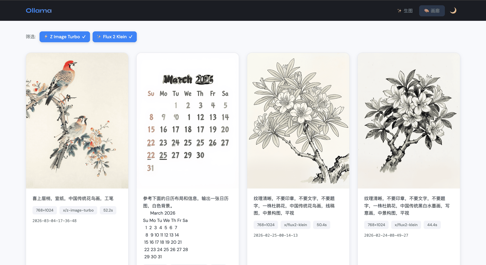
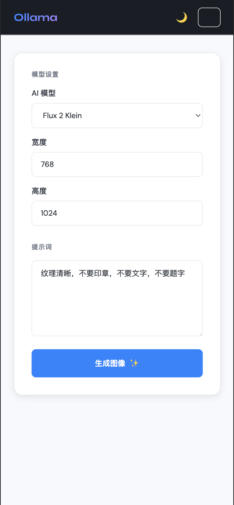
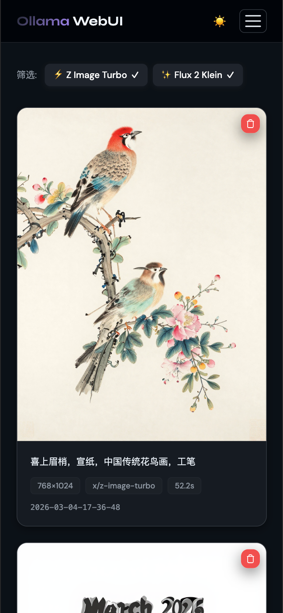

# 🎨 Ollama WebUI for Image Generate

> **为什么做这个项目？**

Ollama 是优秀的本地 LLM 运行工具，但它缺乏图像生成的可视化界面。用户必须通过命令行或 API 调用来生成图片，体验不够友好。

这个项目填补了这个空白——为 Ollama 的图像生成能力提供一个简洁易用的 Web 界面，让你能在浏览器中直接生成图片，无需记忆命令或编写代码。

---

## 🎯 支持的模型

本项目专门优化适配以下两个 Ollama 图像生成模型：

| 模型 | 特点 | 链接 |
|------|------|------|
| **x/flux2-klein** | 高质量图像生成，适合需要精细场景的创作 | [ollama.com/x/flux2-klein](https://ollama.com/x/flux2-klein) |
| **x/z-image-turbo** | 快速生成，适合频繁迭代和测试 | [ollama.com/x/z-image-turbo](https://ollama.com/x/z-image-turbo) |

---

## ✨ 核心功能

| 功能 | 说明 |
|------|------|
| **🖼️ 图像生成** | 输入提示词，选择模型和尺寸，一键生成 |
| **🎨 画廊浏览** | 响应式网格展示所有历史生成，支持筛选和删除 |
| **📊 生成统计** | 每张图显示耗时、尺寸、模型等元信息 |
| **💾 自动保存** | 图片存至 `data/images/`，历史记录和设置存至 `data/db.json`（TinyDB） |
| **🌙 深色模式** | 支持明暗主题切换，自动记住偏好 |
| **📱 响应式** | PC 和移动端完美适配 |

---

## 🖼️ 界面预览

### PC 端


### 移动端

<div align="center">
  
  
</div>

---

## 📋 快速开始

### 前置要求

1. **Ollama 已安装并运行**
   ```bash
   # 安装 Ollama (macOS/Linux)
   curl -fsSL https://ollama.com/install.sh | sh

   # 启动 Ollama 服务
   ollama serve
   ```

2. **拉取图像生成模型**（选一个或都安装）
   ```bash
   # 高质量生成（推荐）
   ollama pull x/flux2-klein:9b

   # 快速生成
   ollama pull x/z-image-turbo:fp8
   ```

### 安装与运行

```bash
# 1. 安装 Python 依赖
uv sync

# 2. 启动服务（端口 8090）
uv run python app.py

# 3. 浏览器访问
open http://127.0.0.1:8090
```

### 使用 Docker 运行

```bash
# 1. 构建镜像
docker build -t ollama-webui .

# 2. 运行容器
docker run -d \
  --name ollama-webui \
  -p 8090:8090 \
  -e OLLAMA_HOST=http://host.docker.internal:11434 \
  -v $(pwd)/data:/app/data \
  ollama-webui

# 3. 浏览器访问
open http://127.0.0.1:8090
```

**环境变量：**

| 变量 | 默认值 | 说明 |
|------|--------|------|
| `OLLAMA_HOST` | `http://host.docker.internal:11434` | Ollama API 地址 |
| `PORT` | `8090` | 应用端口 |
| `FLASK_ENV` | `production` | Flask 运行环境 |

**注意：** macOS/Windows 使用 `host.docker.internal` 访问宿主机 Ollama，Linux 请使用宿主机 IP 或 `172.17.0.1`。

---

## 📚 使用指南

### 生成图片

1. 选择模型（推荐 `x/flux2-klein:9b`）
2. 输入提示词（中文或英文均可）
3. 设置尺寸（256-2048，必须是 64 的倍数）
4. 点击"生成图像"等待完成

### 浏览画廊

- 点击导航栏"画廊"查看所有历史生成
- 支持按模型筛选
- 点击图片查看大图
- 悬停可删除图片

---

## 💡 提示词示例

```
一颗苹果，挂在苹果树上，近景，聚集，插画风格
一片火龙果田地，镜头下的火龙果树挂了几颗火龙果，插画风格，近景
一串葡萄，插画风格，田园，近景
枇杷，绿叶，黄色枇杷，古代传统庭院，近景
```

---

## ⚙️ 配置

| 配置项 | 默认值 | 说明 |
|--------|--------|------|
| 端口 | `8090` | 在 `app.py` 末尾修改 |
| Ollama 地址 | `http://127.0.0.1:11434` | 环境变量 `OLLAMA_HOST` |
| 历史记录上限 | 100 条 | 在 `app.py` 中修改 |
| 图片尺寸 | 256-2048 | 必须是 64 的倍数 |

---

## 🐛 故障排除

**问题：找不到模型**
```bash
# 检查已安装的模型
ollama list

# 重新拉取模型
ollama pull x/flux2-klein:9b
```

**问题：无法连接 Ollama**
```bash
# 测试 API 连通性
curl http://127.0.0.1:11434/api/tags

# 检查服务状态
ps aux | grep ollama
```

---

## 📄 许可证

MIT License

---

## 🤝 贡献

欢迎提交 Issue 和 Pull Request！
