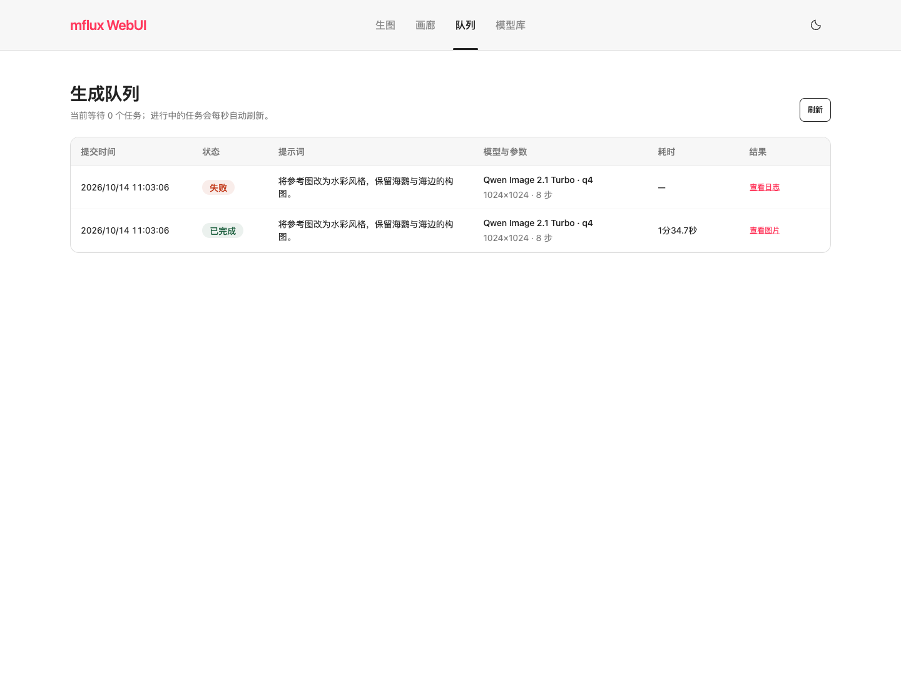
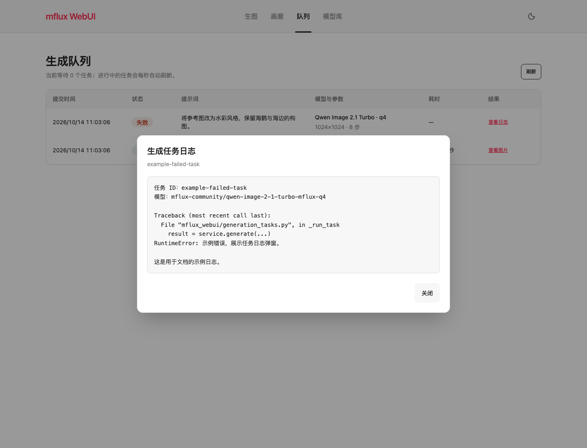

# mflux WebUI 中文文档

希望安装后直接打开使用，可选择 [macOS 桌面版](docs/desktop.md)。桌面版内置 Python/mflux 运行环境，保留现有功能，模型权重首次使用时下载；安装包与预发布状态见 [GitHub Releases](https://github.com/wyf0931/mflux-webui/releases)。

[项目首页](README.md)

一个基于 Flask 的本地图像生成 WebUI，使用 mflux 运行图像模型，支持文生图、图生图、模型缓存管理和生成画廊。

## 功能

- 支持 Qwen Image 2.1 Turbo、Krea 2 Turbo、Z-Image Turbo 和 FLUX.2 Klein 模型系列。
- 使用 Alpine.js、Tailwind CSS 4 与 daisyUI 5，提供轻量、响应式界面。
- 已安装模型置于页面上方，推荐模型按 Hugging Face / ModelScope 渠道切换。
- 使用 Hugging Face 与 ModelScope SDK 的默认缓存目录下载模型。
- 提供 Rausch 浅色主题及深色扩展，使用苹方、微软雅黑等系统中文字体，支持移动端布局。
- 参考图支持本地选择和 ⌘V / Ctrl+V 粘贴，自动预览，可替换或移除；点击生成时上传。
- 高级选项随模型调整：Qwen Image 2.1 Turbo 默认 8 步、引导系数固定为 1.0，支持随机种子和参考图保留强度。

## 界面截图

| 生图 | 画廊 | 模型库 |
| --- | --- | --- |
|  |  |  |

队列与失败日志示例：

| 生成队列 | 完整日志弹窗 |
| --- | --- |
|  |  |

截图使用示例任务，不包含用户的生成历史。

## 环境要求

- macOS Apple Silicon
- Python 3.11 或更高版本
- [uv](https://docs.astral.sh/uv/)
- Node.js 20 或更新版本与 npm

首次生成或下载模型可能需要数 GB 磁盘空间，请根据模型大小准备足够的存储和内存。

Qwen Image 2.1 Turbo 需要上游 PR [#859](https://github.com/mflux-community/mflux/pull/859)
中的加载与采样修复。项目通过 `tool.uv.sources` 固定对应提交，因为 PyPI 的
mflux 0.22.0 尚未包含这些改动。固定提交为 `602b26d242eb7ea9df2a765162a7f35c45c7a143`，
使用 `uv sync` 安装即可，不需要单独安装全局 mflux。Q4 仓库自带全部模型组件，
无需另行下载 VAE 或文本编码器。默认使用 8 步、引导系数 1.0，建议使用 1024×1024 或更大尺寸。

## 安装

```bash
git clone https://github.com/wyf0931/mflux-webui.git
cd mflux-webui
uv sync
npm install
npm run build
```

## 启动

```bash
uv run python app.py
```

打开 <http://127.0.0.1:8090>。

后台运行：

```bash
./ops.sh start
./ops.sh status
./ops.sh status --watch
./ops.sh logs
./ops.sh restart
./ops.sh stop
```

日志写入 `logs/app.log`，进程 ID 写入 `logs/app.pid`。
`status --watch` 每 5 秒刷新进程 PID 和运行时长；`logs` 会显示最近日志并持续跟踪，不会把监控输出写入日志文件。

## 模型配置与渠道

推荐模型配置位于 [`config/models.json`](config/models.json)，应用启动时加载。每个条目可以分别配置 Hugging Face ID 和 ModelScope ID。

通过 `MODEL_REPO` 控制启用的推荐与下载渠道：

| 值 | 启用渠道 |
| --- | --- |
| `all` | Hugging Face 与 ModelScope，默认值 |
| `huggingface` | 仅 Hugging Face |
| `modelscope` | 仅 ModelScope |

生成队列和模型缓存也可以在 `.env` 中调整：

| 变量 | 默认值 | 说明 |
| --- | --- | --- |
| `MFLUX_MODEL_IDLE_TTL_SECONDS` | `300` | 模型空闲多久后自动卸载，单位为秒。 |
| `MFLUX_QUEUE_MAX_SIZE` | `10` | 最多等待的生成任务数，不包含正在推理的任务。 |

复制环境示例文件并按需修改：

```bash
cp .env.example .env
```

下载使用 `huggingface_hub` 与 `modelscope` 自己管理的默认缓存目录，应用不会搬运或覆盖缓存文件。

## 使用方式

### 文生图

选择已安装模型，输入提示词，选择画面比例后生成。切换模型时自动恢复对应的默认步数和引导设置。高级选项按模型能力显示：

- Qwen Image 2.1 Turbo 默认 8 步，引导系数固定为 1.0，使用专用采样曲线。
- Z-Image Turbo 不使用引导系数；FLUX.2 Klein 使用当前流程的默认引导设置。
- 随机种子留空时自动生成，也可以填写 `0` 到 `4294967295` 的整数，`0` 是有效种子。
- 步数接受 `1` 到 `100` 的整数；非法参数在任务入队前返回错误。

### 图生图

选择 PNG、JPG、JPEG 或 WebP 图片，或在生图页面直接按 ⌘V / Ctrl+V 粘贴截图。
参考图会自动预览并展开高级选项，可替换或移除；点击生成时随请求上传，不会在粘贴后立即执行推理。

支持的浏览器也会提供“从剪贴板粘贴”按钮。如果浏览器拒绝剪贴板读取权限，可以直接使用键盘粘贴；普通提示词文本粘贴不受影响。

当前使用保留构图的图生图模式，参考图保留强度默认 `0.35`，范围为 `0` 到 `1`；值越高，保留原图越多、变化越少。
参考图只作为临时文件使用，生成结束或任务失败后自动删除。

### 模型库

模型页首先展示已安装模型。推荐模型区域提供 Hugging Face 和 ModelScope 两个 Tab，支持查看仓库、下载、查看进度和取消任务。

### 生图反馈与队列

提交生成后，服务会立即返回任务 ID，并由单个 GPU worker 按提交顺序执行。生图页会显示排队位置、前方任务数和 ETA；生成中显示已耗时。队列页面展示提交时间、状态、提示词、模型与参数、耗时和结果。模型名称与生图下拉框一致，仓库 ID 可通过模型名的提示查看。

成功任务使用“查看图片”文字按钮；失败任务使用同样样式的“查看日志”文字按钮。点击后通过 daisyUI 原生对话框显示完整日志，可滚动查看，使用关闭按钮、弹窗外区域或 Esc 关闭。

更新后产生的失败任务会保存任务级堆栈；历史记录如果没有保存堆栈，会显示当时记录的完整错误信息。
日志只在打开弹窗时读取，列表不会反复传输完整堆栈。

模型在首次生成时加载并复用；默认连续 5 分钟没有新任务后自动卸载。服务重启不会恢复此前未完成的任务。

## 前端主题与组件

页面统一使用 daisyUI 5 的按钮、表单控件、卡片、标签、导航、菜单、表格和对话框，Tailwind 负责布局，Alpine.js 负责交互。
默认白色画布、Rausch 红色主操作和独立柔灰导航；保留明暗切换，不加载外部字体。主题选择保存在 `mflux.theme`。

主题配置及组件约定见 [docs/theme.md](docs/theme.md)，Qwen 模型接入与排查见 [docs/qwen-image-21-turbo.md](docs/qwen-image-21-turbo.md)。

## 数据位置

| 内容 | 位置 |
| --- | --- |
| 生成图片 | `data/images/` |
| 生成历史、队列记录及任务日志 | `data/db.json` |
| 临时参考图 | `data/uploads/` |
| 应用日志 | `logs/app.log` |
| 模型权重 | SDK 默认缓存目录 |

## 开发检查

```bash
uv run python -m unittest discover -s tests
node --test tests/js/*.test.cjs
uv lock --check
uv run --with ruff ruff check app.py mflux_webui tests
npm run build
uv run python -m compileall app.py mflux_webui tests
```

## 项目结构

```text
mflux_webui/       Flask 应用包、路由、服务和前端资源
config/            推荐模型配置
tests/             单元测试与 mock 推理测试
data/              运行时图片与历史数据
docs/              设计记录与截图
app.py             兼容旧命令的开发启动入口
```

## 参与贡献

欢迎提交 Issue 和 Pull Request。提交前请说明用户可见的行为变化，Bug 请提供复现步骤，并运行开发检查命令。

## 许可证

本项目使用 [ISC License](LICENSE)。
