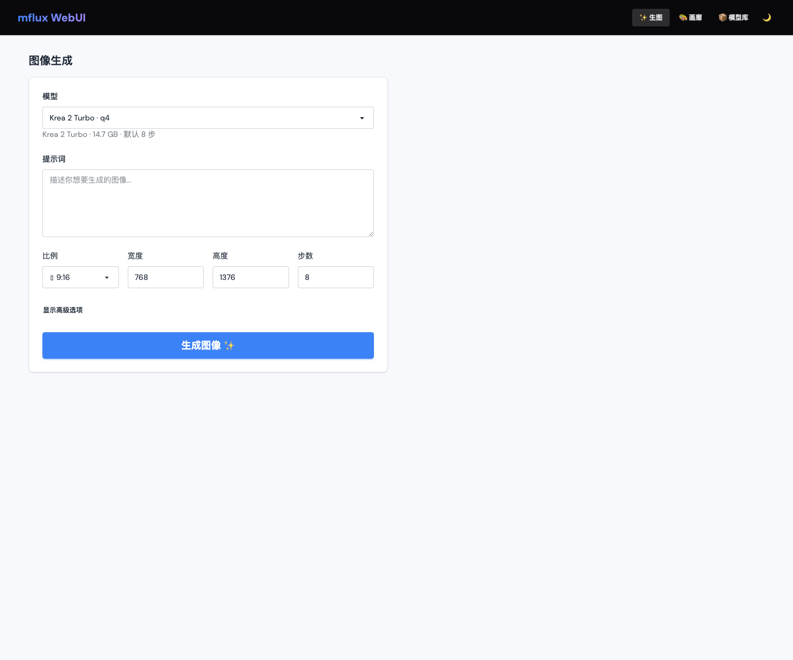
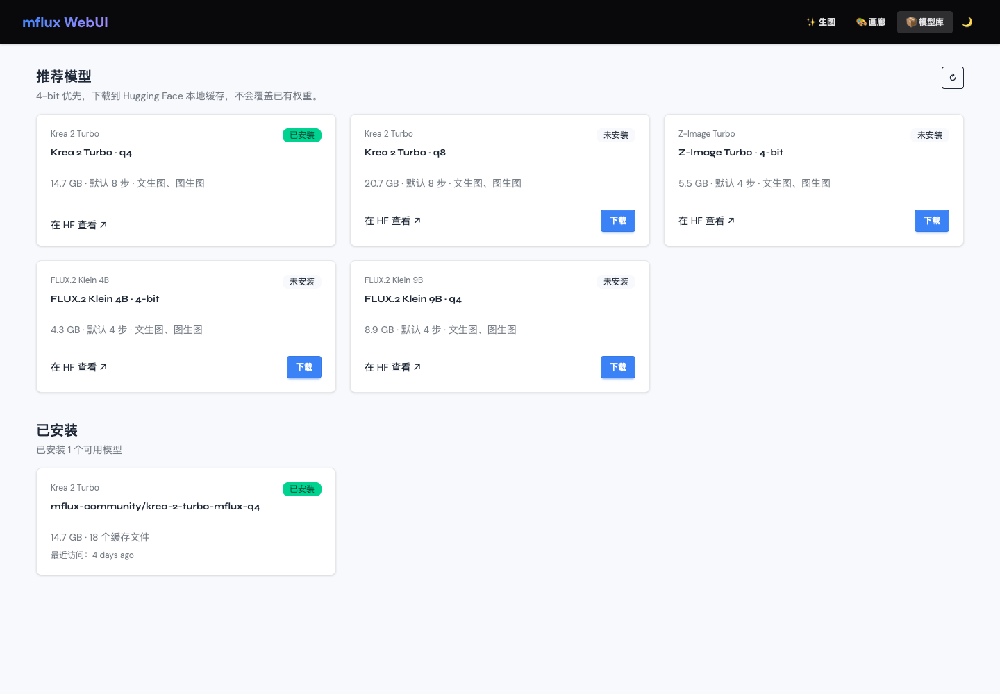

# mflux WebUI 中文文档

[English README](README.md)

一个基于 Flask 的本地图像生成 WebUI，使用 mflux 运行图像模型，支持文生图、图生图、模型缓存管理和生成画廊。

## 功能

- 支持 Krea 2 Turbo、Z-Image Turbo 和 FLUX.2 Klein 模型系列。
- 使用 Alpine.js 与 DaisyUI，提供轻量、响应式界面。
- 已安装模型置于页面上方，推荐模型按 Hugging Face / ModelScope 渠道切换。
- 使用 Hugging Face 与 ModelScope SDK 的默认缓存目录下载模型。
- 支持深色模式、移动端布局、参考图生图和历史画廊。

## 界面截图

| 生图 | 画廊 | 模型库 |
| --- | --- | --- |
|  |  |  |

## 环境要求

- macOS Apple Silicon
- Python 3.11 或更高版本
- [uv](https://docs.astral.sh/uv/)
- Node.js 与 npm

首次生成或下载模型可能需要数 GB 磁盘空间，请根据模型大小准备足够的存储和内存。

## 安装

```bash
git clone https://github.com/wyf0931/mflux-webui.git
cd mflux-webui
uv sync
npm install
npm run build
```

## 启动

```bash
uv run python app.py
```

打开 <http://127.0.0.1:8090>。

后台运行：

```bash
./ops.sh start
./ops.sh status
./ops.sh status --watch
./ops.sh logs
./ops.sh restart
./ops.sh stop
```

日志写入 `logs/app.log`，进程 ID 写入 `logs/app.pid`。
`status --watch` 每 5 秒刷新进程 PID 和运行时长；`logs` 会显示最近日志并持续跟踪，不会把监控输出写入日志文件。

## 模型配置与渠道

推荐模型配置位于 [`config/models.json`](config/models.json)，应用启动时加载。每个条目可以分别配置 Hugging Face ID 和 ModelScope ID。

通过 `MODEL_REPO` 控制启用的推荐与下载渠道：

| 值 | 启用渠道 |
| --- | --- |
| `all` | Hugging Face 与 ModelScope，默认值 |
| `huggingface` | 仅 Hugging Face |
| `modelscope` | 仅 ModelScope |

生成队列和模型缓存也可以在 `.env` 中调整：

| 变量 | 默认值 | 说明 |
| --- | --- | --- |
| `MFLUX_MODEL_IDLE_TTL_SECONDS` | `300` | 模型空闲多久后自动卸载，单位为秒。 |
| `MFLUX_QUEUE_MAX_SIZE` | `10` | 最多等待的生成任务数，不包含正在推理的任务。 |

复制环境示例文件并按需修改：

```bash
cp .env.example .env
```

下载使用 `huggingface_hub` 与 `modelscope` 自己管理的默认缓存目录，应用不会搬运或覆盖缓存文件。

## 使用方式

### 文生图

选择已安装模型，输入提示词，选择画面比例后生成。高级选项支持推理步数、引导系数和随机种子。

### 图生图

上传 PNG、JPG、JPEG 或 WebP 参考图，将参考图强度设置为 `0` 到 `1`。参考图只作为临时文件使用，生成结束后自动删除。

### 模型库

模型页首先展示已安装模型。推荐模型区域提供 Hugging Face 和 ModelScope 两个 Tab，支持查看仓库、下载、查看进度和取消任务。

### 生图反馈与队列

提交生成后，服务会立即返回任务 ID，并由单个 GPU worker 按提交顺序执行。生图页会显示排队位置、前方任务数和 ETA；生成中显示已耗时。可在“队列”页面查看最近任务、参数、结果与失败原因。

模型在首次生成时加载并复用；默认连续 5 分钟没有新任务后自动卸载。服务重启不会恢复此前未完成的任务。

## 数据位置

| 内容 | 位置 |
| --- | --- |
| 生成图片 | `data/images/` |
| 生成历史 | `data/db.json` |
| 临时参考图 | `data/uploads/` |
| 应用日志 | `logs/app.log` |
| 模型权重 | SDK 默认缓存目录 |

## 开发检查

```bash
uv run python -m unittest discover -s tests
uv lock --check
uv run --with ruff ruff check app.py mflux_webui tests
npm run build
uv run python -m compileall app.py mflux_webui tests
```

## 项目结构

```text
mflux_webui/       Flask 应用包、路由、服务和前端资源
config/            推荐模型配置
tests/             单元测试与 mock 推理测试
data/              运行时图片与历史数据
docs/              设计记录与截图
app.py             兼容旧命令的开发启动入口
```

## 参与贡献

欢迎提交 Issue 和 Pull Request。提交前请说明用户可见的行为变化，Bug 请提供复现步骤，并运行开发检查命令。

## 许可证

本项目使用 [ISC License](LICENSE)。
